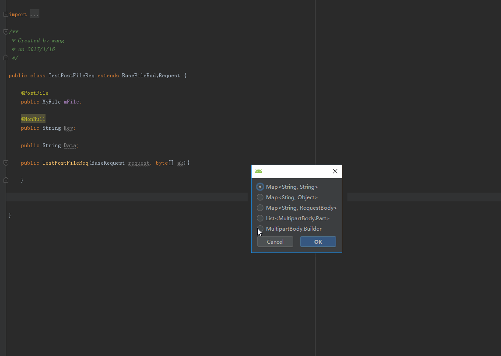
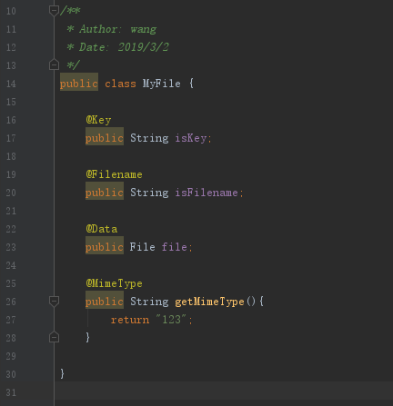

# OkHttpParamsGet #
[中文](https://github.com/kingwang666/OkHttpParamsGet/blob/master/README_CN.md)  
Help you to get Okhttp request params. Support Kotlin.  
**This is IntelliJ IDEA and Android Studio plugins. If you need [gradle plugins](https://github.com/kingwang666/HttpParam) please click.**  

<!-- Plugin description -->
## About this project ##
This project is a plugin that help you to get Okhttp request params.  
[Homepage](https://plugins.jetbrains.com/plugin/9545-okhttpparamsget) | [Github](https://github.com/kingwang666/OkHttpParamsGet)
## Support ##
1. Map&lt;String, String&gt;
2. Map&lt;String, Object&gt;
3. Map&lt;String, RequestBody&gt;
4. List&lt;MultipartBody.Part&gt;
5. MultipartBody.Builder
## How to use ##
1. Choose a class.
2. Press Alt + P or click the Generate menu choose GetParams.
3. Choose a type.
4. click ok.
## Annotations ##
**These annotations can be in any package**
- @Ignore: dont add to params
- @PostFile: post file. Support single, list, array and map
- @ParamName: custom param name
- <S>@PostFiles: post files.</S> Removed use @PostFile
- @Key: post file key
- @Filename: post file filename
- @MimeType: post file mime-type
- @Data: post file data.

<!-- Plugin description end -->

</img> </img>

## How to install ##
File->Settings->Browse Repositories->OkHttpParamsGet
